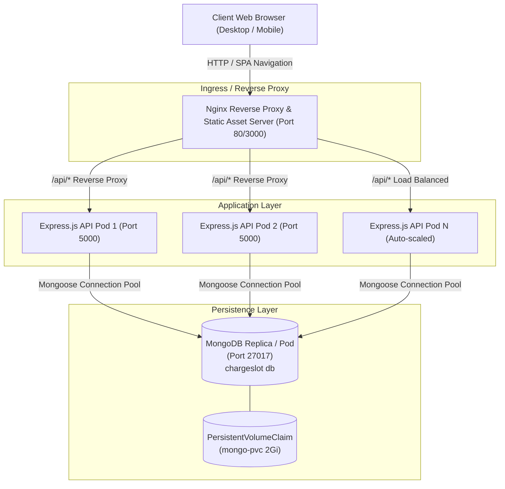
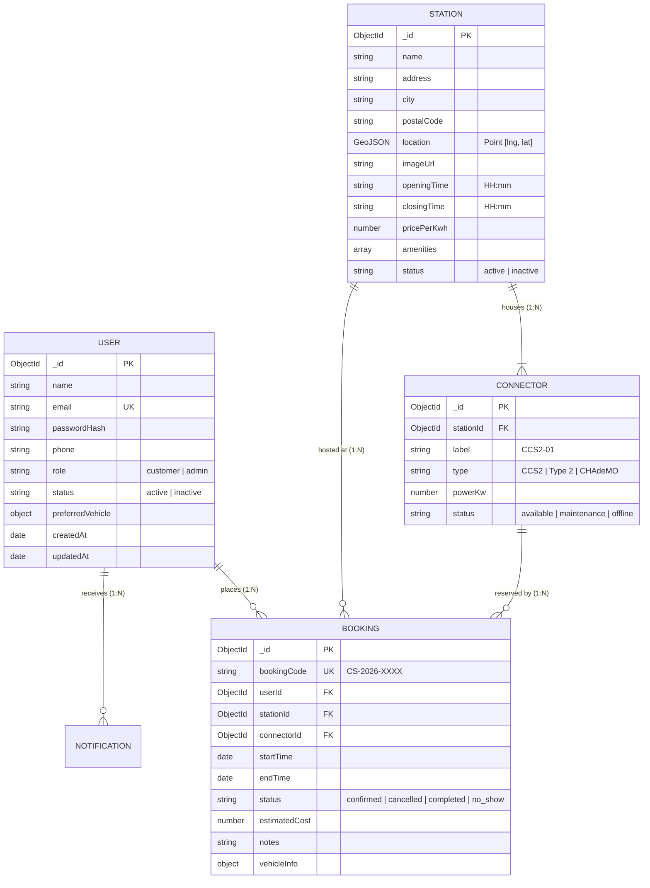

# ChargeSlot — System Architecture & Concurrency Blueprint ⚡

ChargeSlot is a cloud-native Electric Vehicle (EV) Charging Station Reservation Platform engineered with a React.js client, an Express.js REST API service, and a MongoDB persistence tier, packaged in Docker containers and orchestrated with Kubernetes.

---

## 1. High-Level System Architecture



---

## 2. Database Schema & Entity Relationships

The data model is deliberately normalized across four primary collections to avoid unbounded array growth while maintaining relational integrity.



---

## 3. Atomic Overlapping Booking Conflict Prevention

### The Mathematical Overlap Condition

To ensure that two reservations never collide on the exact same physical connector, an overlap occurs if and only if:

$$\text{existing.startTime} < \text{requested.endTime} \quad \land \quad \text{existing.endTime} > \text{requested.startTime}$$

### Edge Case Matrix: Adjacent Slots vs Overlapping Slots

| Case | Existing Slot | Requested Slot | Overlap? | Action |
|---|---|---|---|---|
| **Case A (Disjoint Past)** | 10:00 - 11:00 | 12:00 - 13:00 | **No** (11:00 $\le$ 12:00) | **Accepted** |
| **Case B (Adjacent Preceding)** | 10:00 - 11:00 | 11:00 - 12:00 | **No** (11:00 < 11:00 is False) | **Accepted** |
| **Case C (Partial Overlap)** | 10:00 - 11:00 | 10:30 - 11:30 | **Yes** (10:00 < 11:30 and 11:00 > 10:30) | **Rejected (409 Conflict)** |
| **Case D (Complete Enclosure)** | 10:00 - 12:00 | 10:30 - 11:30 | **Yes** (10:00 < 11:30 and 12:00 > 10:30) | **Rejected (409 Conflict)** |
| **Case E (Enclosing Requested)** | 10:30 - 11:00 | 10:00 - 12:00 | **Yes** (10:30 < 12:00 and 11:00 > 10:00) | **Rejected (409 Conflict)** |

### Compound Indexes for Instant Query Execution

MongoDB utilizes a compound index on the `bookings` collection:
```javascript
bookingSchema.index({ connectorId: 1, status: 1, startTime: 1, endTime: 1 });
```
This guarantees sub-millisecond execution times even with hundreds of thousands of historical records.
